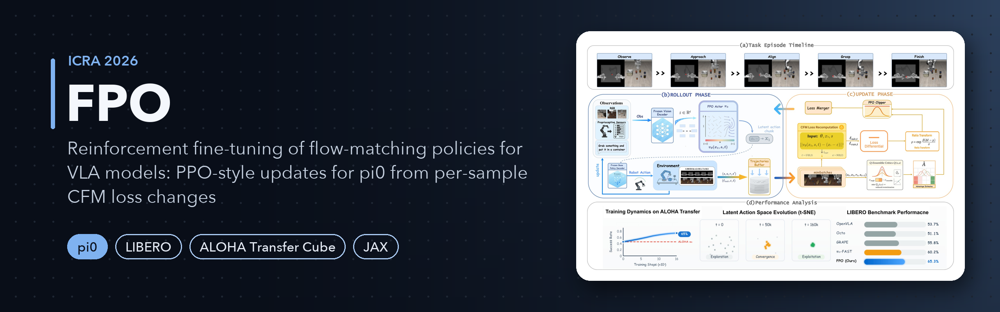
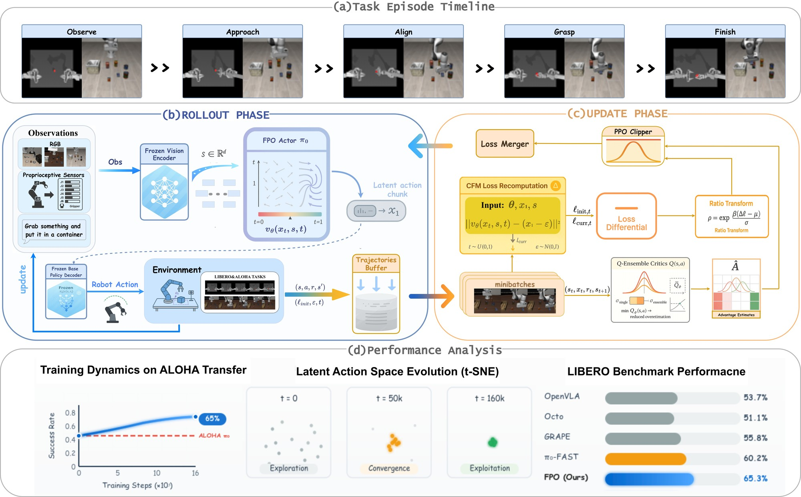
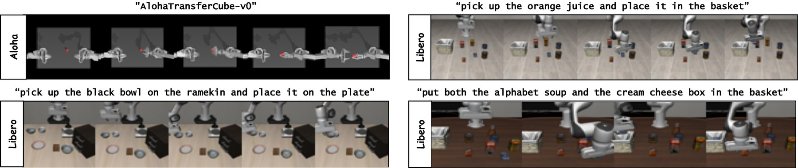
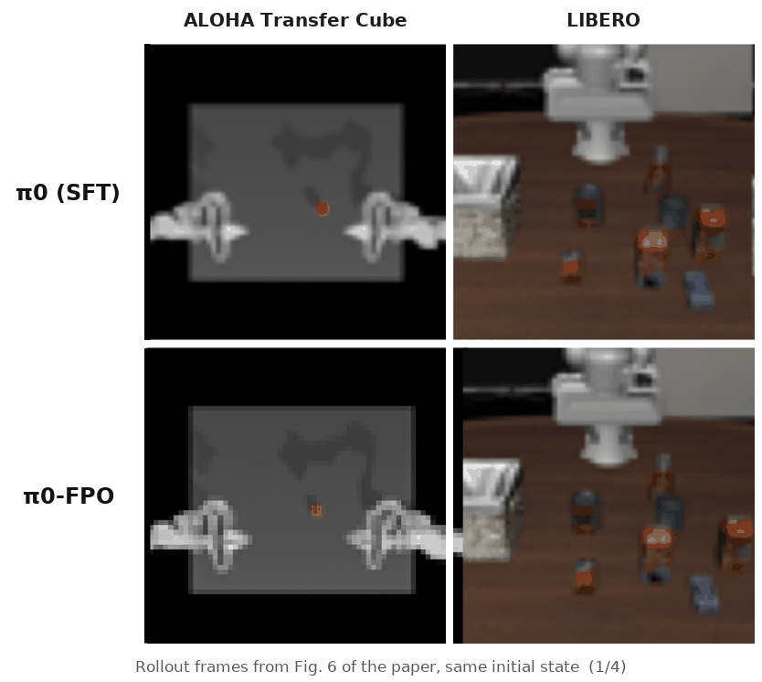
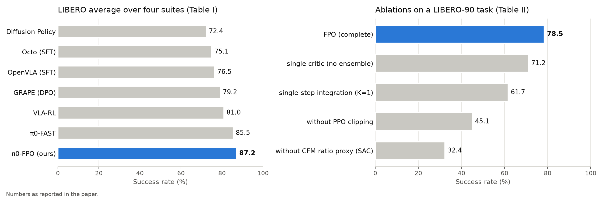
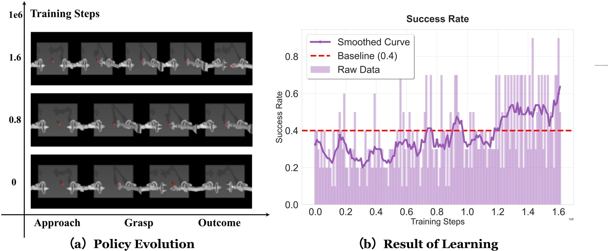

<p align="center">
  
</p>

<p align="center">
  
  <a href="https://arxiv.org/abs/2510.09976"></a>
  <a href="LICENSE"></a>
  
  
</p>

<h1 align="center">Reinforcement Fine-Tuning of Flow-Matching Policies for Vision-Language-Action Models</h1>

<p align="center">
Mingyang Lyu<sup>a,b,e,1</sup>,
Yinqian Sun<sup>a,b,d,f,1</sup>,
Erliang Lin<sup>a</sup>,
Huangrui Li<sup>d</sup>,
Ruolin Chen<sup>a,b,e</sup>,
Feifei Zhao<sup>a,b,d,f,2</sup>,
Yi Zeng<sup>a,b,c,d,e,f,2</sup>
</p>

<p align="center"><sub>
<sup>a</sup> Brain-inspired Cognitive AI Lab, Institute of Automation, Chinese Academy of Sciences, Beijing, China &nbsp;
<sup>b</sup> Beijing Institute of AI Safety and Governance, China &nbsp;
<sup>c</sup> State Key Laboratory of Brain Cognition and Brain-inspired Intelligence Technology &nbsp;
<sup>d</sup> Beijing Key Laboratory of Safe AI and Superalignment, China &nbsp;
<sup>e</sup> University of Chinese Academy of Sciences (UCAS), Beijing, China &nbsp;
<sup>f</sup> Long-term AI, Beijing, China
<br>
<sup>1</sup> Co-first authors &nbsp; <sup>2</sup> Co-corresponding authors
</sub></p>

<p align="center"><b>Accepted to the 2026 IEEE International Conference on Robotics and Automation (ICRA 2026), Vienna, Austria.</b><br>
<a href="https://arxiv.org/abs/2510.09976">arXiv:2510.09976</a></p>

<p align="center"><a href="README_zh.md">中文说明</a></p>

**TL;DR** Flow Policy Optimization (FPO) fine-tunes the flow-matching VLA policy pi0 online
with PPO-style clipped updates, replacing the intractable likelihood ratio by a ratio built
from per-sample changes in the conditional flow-matching (CFM) loss.

<p align="center">
  
  <br><sub>Paper Fig. 1. (a) Task episode. (b) Rollout: the actor outputs a latent chunk, the frozen pi0 decodes it into actions; the CFM loss under the rollout actor is cached with the transition. (c) Update: the CFM loss is recomputed under the current actor, the loss differential is mapped to a likelihood-free ratio, a Q-ensemble supplies advantages, and the actor takes a clipped-surrogate step.</sub>
</p>

## Highlights

- **Likelihood-free ratio.** For each stored pair (s_t, x_t), Delta l = l_cfm(x_t | s_t; theta_old) - l_cfm(x_t | s_t; theta) is standardised over the batch and mapped to rho = exp(beta z) (Eqs. 2-3), so PPO-style updates need no ODE likelihoods or Jacobian traces.
- **Clipped surrogate** (Eq. 4) for trust-region control, with advantages from a **Q-ensemble** (conservative minimum, GAE; Eqs. 5-6).
- **Multi-step latent exploration**: the actor's latent is produced by K Euler steps of its flow (Eq. 7) and decoded by the frozen pi0.
- **Paper settings and ablations as switches**: LIBERO (four suites and the LIBERO-90 ablation task) and ALOHA Transfer Cube; every Table II variant is one flag.

## Method and benchmarks

FPO is an actor-critic method on top of a frozen pi0. The actor pi_theta(x | s) is a
conditional flow (own image encoder and MLP velocity head) that outputs the noise latent pi0 starts its own flow from;
pi0 then decodes the observation and the latent into an action
chunk. Training alternates a rollout phase with a frozen copy theta_old (which caches the
per-sample CFM loss of every executed latent) and an update phase on a sliding window of
recent rollouts (Algorithm 1). Every equation, setting and default is mapped to the code in
[`docs/PAPER_ALIGNMENT.md`](docs/PAPER_ALIGNMENT.md).

<p align="center">
  
  <br><sub>Paper Fig. 2. ALOHA Transfer Cube (bimanual, contact-rich) and LIBERO multi-object manipulation tasks.</sub>
</p>

## Rollouts

<p align="center">
  
  <br><sub>The four rollout frames of paper Fig. 6 shown in order: pi0 before fine-tuning (top) fails from a side grasp; after FPO (bottom) the same initial state is solved with a top-down grasp. Circles are the paper's annotations.</sub>
</p>

<!-- Space for a rollout video GIF of trained policies (to be added if released). -->

## Results (from the paper)

**LIBERO, success rate (%)** (paper Table I; ranks omitted)

| Method | Spatial | Object | Goal | Long | Average |
|---|---:|---:|---:|---:|---:|
| Diffusion Policy | 78.3 | 92.5 | 68.3 | 50.5 | 72.4 |
| GRAPE (DPO) | 87.6 | 91.2 | 82.2 | 55.8 | 79.2 |
| Octo (SFT) | 78.9 | 85.7 | 84.6 | 51.1 | 75.1 |
| OpenVLA (SFT) | 84.7 | 88.4 | 79.2 | 53.7 | 76.5 |
| VLA-RL | 90.2 | 91.8 | 82.2 | 59.8 | 81.0 |
| pi0-FAST | 96.4 | 96.8 | 88.6 | 60.2 | 85.5 |
| **pi0-FPO (ours)** | **97.2** | **97.3** | **89.4** | **65.3** | **87.2** |

**Ablations on LIBERO-90 "pick up the butter and put it in the tray"** (paper Table II, final success rate %):
FPO (complete) 78.5; without CFM ratio proxy (SAC-style latent update) 32.4; without PPO clipping 45.1;
single-step integration (K = 1) 61.7; single critic (without ensemble) 71.2.

**ALOHA Transfer Cube** (paper Fig. 4): starting from pi0 at about 40% success, FPO exceeds 65%.

<p align="center">
  
</p>

<p align="center">
  
  <br><sub>Paper Fig. 4. (a) Policy at 0 / 0.8M / 1.6M training steps. (b) Success-rate curve against the 40% pi0 baseline.</sub>
</p>

## Installation

Linux with an NVIDIA GPU (CUDA 12).

```bash
conda create -n fpo python=3.11.11
conda activate fpo

git clone --recurse-submodules https://github.com/tuotuoLyu/FPO.git
cd FPO

pip install -e .
pip install -r requirements.txt
pip install "jax[cuda12]==0.5.0"

# pi0 (openpi fork pinned as a submodule)
pip install -e openpi
pip install -e openpi/packages/openpi-client

# LIBERO (fork pinned as a submodule)
pip install -e LIBERO
pip install torch==2.6.0 --index-url https://download.pytorch.org/whl/cpu   # needed by LIBERO
```

pi0 checkpoints (`pi0_libero`, `pi0_aloha_sim`) are downloaded by openpi on first use into
`$OPENPI_DATA_HOME` (the scripts default to `./openpi`). Logging uses Weights & Biases;
copy `jaxrl2/utils/wandb_config_example.py` to `jaxrl2/utils/wandb_config.py` (git-ignored)
or pass `--use_wandb 0`.

## Quick start

**1. CPU checks (NumPy only, a few seconds).**

```bash
python -m unittest discover -s tests -v      # FPO math: ratio proxy, clipped surrogate, Q-ensemble targets, GAE, Euler sampler
python scripts/smoke_cpu.py                  # Algorithm 1 end to end on a toy latent-steering task
python scripts/check_loop_cpu.py             # replay window, GAE and the real rollout/update loop with stand-ins for JAX, gym and pi0
python scripts/smoke_cpu.py --no_clip        # ablation switches run through the same loop
python scripts/smoke_cpu.py --euler_steps 1
python scripts/smoke_cpu.py --num_qs 1
```

With JAX, Flax and gym installed, `tests/test_fpo_jax.py` additionally checks the JAX
implementation against the NumPy reference and runs one learner update on CPU
(`JAX_PLATFORMS=cpu python -m unittest tests.test_fpo_jax -v`).

**2. Training (GPU).**

```bash
# LIBERO-90 "pick up the butter and put it in the tray" (Table II, FPO complete)
bash examples/scripts/run_fpo_libero.sh

# Table I protocol: one run per task of a suite
bash examples/scripts/run_fpo_libero_suite.sh libero_10        # also libero_spatial | libero_object | libero_goal

# ALOHA Transfer Cube (Fig. 4)
bash examples/scripts/run_fpo_aloha.sh

# Table II ablations: full | no_ratio | no_clip | one_step | single_critic | all
bash examples/scripts/run_fpo_ablations.sh all
```

Useful environment variables: `CUDA_VISIBLE_DEVICES` (the batch size, 210 for LIBERO and 192
for ALOHA, must be divisible by the number of visible GPUs), `OPENPI_DATA_HOME`, `EXP` (output
root, default `./logs/<project>`), `JAX_COMPILATION_CACHE_DIR`. Any flag of
`examples/launch_train_fpo.py` can be appended to the scripts, e.g.
`bash examples/scripts/run_fpo_libero.sh --seed 1 --save_latents 1`.

**3. Latent-space analysis (Fig. 5).** Train with `--save_latents 1`, then
`python analysis/latent_evolution.py --latent_dir <output dir>/latents --out fig5.png`
(needs scikit-learn).

## Repository layout

```
FPO/
├── jaxrl2/                         # agents, networks, replay buffers
│   ├── agents/pixel_fpo/           # FPO: fpo_math.py, noise_flow_policy.py, fpo_actor_updater.py, pixel_fpo_learner.py
│   ├── agents/pixel_sac/           # latent SAC (Table II "without CFM ratio proxy")
│   └── data/replay_buffer_fpo.py   # sliding-window buffer, cached CFM losses, GAE
├── examples/
│   ├── launch_train_fpo.py         # FPO entry point (all hyper-parameters are flags)
│   ├── train_fpo.py                # environments, pi0, learner, buffer
│   ├── train_utils_fpo.py          # rollout / update loop (Algorithm 1), evaluation
│   └── scripts/run_fpo_*.sh        # paper settings and ablations
├── analysis/latent_evolution.py    # Fig. 5
├── scripts/                        # smoke_cpu.py, check_loop_cpu.py, plot_paper_results.py
├── tests/                          # NumPy tests (+ JAX tests, skipped without JAX)
├── docs/                           # PAPER_ALIGNMENT.md
├── openpi/  LIBERO/                # git submodules (pinned)
└── assets/
```

## Paper alignment

[`docs/PAPER_ALIGNMENT.md`](docs/PAPER_ALIGNMENT.md) maps every component of the paper
(Eqs. 1-7, Algorithm 1, Tables I-II, Figs. 3-5) to code and default values, and documents
the implementation choices for details the paper does not specify. The CPU tests in Quick start cover the FPO math (`tests/`), Algorithm 1 on a toy
task (`scripts/smoke_cpu.py`) and the replay window and training loop
(`scripts/check_loop_cpu.py`).

## Citation

```bibtex
@inproceedings{lyu2026fpo,
  title         = {Reinforcement Fine-Tuning of Flow-Matching Policies for Vision-Language-Action Models},
  author        = {Lyu, Mingyang and Sun, Yinqian and Lin, Erliang and Li, Huangrui and Chen, Ruolin and Zhao, Feifei and Zeng, Yi},
  booktitle     = {2026 IEEE International Conference on Robotics and Automation (ICRA)},
  year          = {2026},
  eprint        = {2510.09976},
  archivePrefix = {arXiv},
}
```

## License

MIT, see [`LICENSE`](LICENSE). Third-party components and their licences are listed in
[`THIRD_PARTY.md`](THIRD_PARTY.md).
